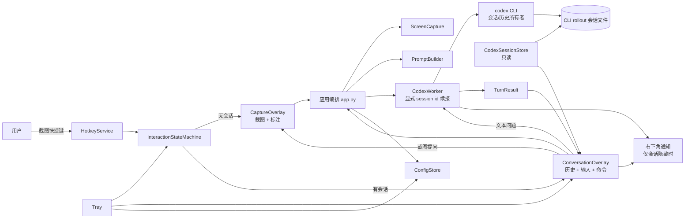
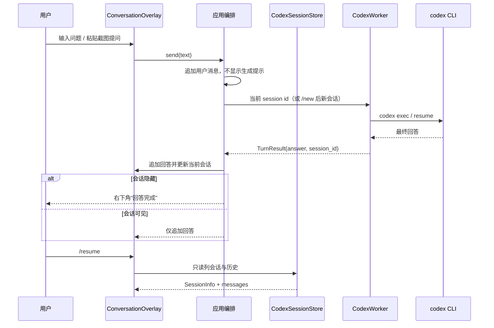

# ScreenToAgent 架构设计

| 项目 | 内容 |
| --- | --- |
| 文档类型 | 架构设计（Architecture） |
| 状态 | 实现中（M1/M2 原型） |
| 版本 | 1.3 |
| 更新日期 | 2026-11-14 |
| 对应需求 | [REQ-2026-11-14-001](2026-11-14-截图提问转发Agent/requirements.md)、[REQ-2026-11-14-002](2026-11-14-会话式回答界面/requirements.md)、[REQ-2026-11-14-003](2026-11-14-模型切换流式输出与图片历史/requirements.md)、[REQ-2026-11-14-004](2026-11-14-存储位置与输入快捷键设置/requirements.md)、[REQ-2026-11-14-005](2026-11-14-会话字体大小设置/requirements.md) |

## 变更记录

| 版本 | 日期 | 变更内容 |
| --- | --- | --- |
| 0.1 | 2026-11-14 | 初稿：分层、后端适配、线程模型、配置与安全。 |
| 0.2 | 2026-11-14 | 默认热键 F1；图上文字标注与烧录；回答完成通知；F1 状态机；全屏半透明回答层。 |
| 0.3 | 2026-11-14 | 应用不再管理 Agent 会话：CLI 会话/历史归 CLI，API 单轮无上文；移除本地历史库；新增 CLI 历史读取与内存最近回答；状态机更名为交互状态机。 |
| 0.4 | 2026-11-14 | 实现 M1 原型；F1 注册冲突时回退到受限低级键盘监听；实际调用 `codex exec` 与 `codex exec resume --last`；补充当前实现状态。 |
| 0.5 | 2026-11-14 | 新增快捷键设置与冲突校验：设置对话框、临时注册探测、严格应用失败回滚、配置持久化与提示文案同步。 |
| 0.6 | 2026-11-14 | 完成 PyInstaller 单文件 exe 构建：build.bat、应用图标、目标机 Codex CLI 外置依赖与打包冒烟。 |
| 0.7 | 2026-11-14 | 实现会话式回答界面：历史、底部输入、默认旧会话、`/new`、`/resume` 选择器、只读 rollout 会话存储；移除生成状态层；完成通知仅在会话隐藏时弹出。 |
| 0.8 | 2026-11-14 | 截图快捷键改为长按/轻点：250ms 长按进入框选，轻点且未选择时显示/切换会话；消息模式轮询按键释放，监听模式直接接收 keyup。 |
| 0.9 | 2026-11-14 | 截图输入支持草稿保持：Ctrl+Enter 发送；截图/标注中再按热键、Esc 或取消退出时保存标注文本，下次框选后回填，发送后清空。 |
| 1.0 | 2026-11-14 | 实现 REQ-003：模型选择、Codex JSONL 与 API SSE 流式、附件缓存与历史图片展示；API 后端按配置启用，密钥暂用环境变量。 |
| 1.1 | 2026-11-14 | 实现 REQ-004：附件存储根目录可配置、启动回退与清理边界；截图/会话输入发送与退出快捷键可配置并校验冲突。 |
| 1.2 | 2026-11-14 | 实现 REQ-005：会话字号可配置（9–24pt，默认 13），设置页实时预览，历史正文与输入框即时重绘并持久化到 `conversation.font_size`。 |
| 1.3 | 2026-11-14 | REQ-005 补充：角色标签固定比正文大 2pt；历史图片宽度可配置（`conversation.image_width`，160–1200px，默认 360），即时重绘与持久化。 |

## 1. 架构目标与约束

- **平台**：Windows 10/11 x64，Python 3.11+；v1 不考虑跨平台。
- **不管理 Agent 会话**：应用不保存、不重放、不拼接对话上下文；CLI 模式由 CLI 管理会话，API 模式固定单轮。
- **F1 单一入口**：F1 是上下文相关热键，由 `InteractionStateMachine` 统一裁决，禁止多个组件各自响应。
- **图上提问**：文字标注直接渲染在截图上，同时作为本次问题文本发送；不附加历史内容。
- **UI 永不阻塞**：截屏、子进程、HTTP 请求、CLI 历史查询均不得在 UI 线程执行。
- **不截自身**：任何截图动作前必须隐藏会话界面、通知与设置窗口。
- **后端可插拔**：新增 Agent 后端不修改 UI 与编排逻辑。
- **最小敏感数据**：截图以内存为主；API Key 使用 Windows DPAPI 加密；日志不含提问正文、标注文字与回答内容。
- **无本地问答库**：应用只保存配置、加密凭据与脱敏日志；不建立会话数据库。
- **依赖精简**：GUI 用 PySide6，HTTP 用 httpx，其余尽量使用标准库。

## 2. 技术选型

| 领域 | 选型 | 理由 |
| --- | --- | --- |
| GUI | PySide6（Qt 6，LGPL） | 无边框遮罩、HiDPI、多屏、托盘、滚动文本与 Markdown 展示成熟。 |
| 屏幕捕获 | Qt `QScreen.grabWindow` + 内存裁剪 | 无需额外依赖；按屏幕逐块抓取可处理混合 DPI。 |
| 全局热键 | Win32 `RegisterHotKey`（`VK_F1`）+ 释放轮询；冲突时回退 `WH_KEYBOARD_LL`（含 keyup） | 支持按下/释放时长判定；回退监听只匹配配置热键，不拦截或记录其他按键。 |
| 图上标注 | QPainter 绘制文本项 + 烧录到 QImage | 与 Qt 渲染一致，标注所见即所得；无额外依赖。 |
| 回答/会话层 | 无边框透明 QWidget + QTextBrowser + 底部输入栏 + 模型选择器 | 全屏半透明、历史滚动、Markdown、流式更新、图片缩略图。 |
| 完成通知 | `QSystemTrayIcon.showMessage` + 托盘图标状态 | 仅会话隐藏时提示，避免重复打扰；无生成提示。 |
| 本地 Agent | `subprocess.Popen`（参数列表，`shell=False`） | 复用用户已登录的 CLI；会话与历史归 CLI；CLI JSONL 事件流。 |
| CLI 会话存储 | 只读解析 `~/.codex/sessions/**/rollout-*.jsonl[.zst]` | 获取会话列表与历史；应用不写入、不建立本地会话库。 |
| 模型目录 | `codex debug models --bundled` JSON | 获取 slug/显示名/图片能力；不修改用户全局配置。 |
| API 流式 | httpx + SSE（`text/event-stream`） | 单轮请求、增量文本、取消与超时。 |
| 附件缓存 | 内容寻址文件（`%APPDATA%\ScreenToAgent\attachments`） | 历史图片可回看；只读展示，不作为上下文重发。 |
| 远程 Agent | `httpx`（异步 + SSE） | 单轮请求简单，超时与取消语义清晰。 |
| 配置 | JSON（`%APPDATA%\ScreenToAgent\config.json`） | 可读、可手工排查、便于迁移。 |
| 凭据 | Windows DPAPI（`CryptProtectData`，经 ctypes 调用） | 与当前 Windows 用户绑定，不落明文，无需额外依赖。 |
| 打包 | PyInstaller（onedir，`--noconsole`） | 生态成熟；后续可补代码签名。 |
| 质量 | pytest、ruff | 单测与静态检查。 |

### 2.1 关键决策（ADR 摘要）

| ADR | 决策 | 取舍 |
| --- | --- | --- |
| ADR-001 | 采用 PySide6 而非 Tkinter/WinUI | Qt 对遮罩、多屏 DPI、托盘支持最好；代价是安装包较大。 |
| ADR-002 | 后端以 `AgentBackend` 协议隔离 | 后端差异集中在基础设施层；避免 UI 感知 CLI/API 细节。 |
| ADR-003 | 每个请求使用独立 worker 线程 + 事件循环 | 防止阻塞 UI；实现比全局 qasync 简单；线程按请求创建，成本可接受。 |
| ADR-004 | 密钥只存 DPAPI 密文，配置仅存引用 | 避免明文泄漏；代价是配置不可跨机器直接复制。 |
| ADR-005 | 截图先全屏冻结再内存裁剪 | 交互快、无重复抓屏闪烁；混合 DPI 需按屏幕合成。 |
| ADR-006 | CLI 只接受参数列表与 `{image}`、`{prompt}` 占位符 | 杜绝 shell 注入；代价是无法直接使用复杂 shell 管道。 |
| ADR-007 | F1 由单一交互状态机裁决 | 避免“截图/阅读/生成”多组件抢热键；代价是状态转移必须显式测试。 |
| ADR-008 | 标注烧录进图像，同时拼为本次问题文本 | 保证视觉模型看到图上问题，文本模型也能读取；不附加历史。 |
| ADR-009 | 回答层为独立全屏透明置顶窗口 | F1 开关简单、不干扰托盘；代价是需处理焦点、多屏几何与自截屏排除。 |
| ADR-010 | 应用不拥有会话状态 | CLI 会话归 CLI，API 单轮；应用只持有最近一次回答用于展示，不作为上下文。 |
| ADR-011 | 历史查看委托后端 | CLI 查询 CLI 历史；API 仅当前进程内存；不建立本地问答库。 |
| ADR-012 | F1 冲突时允许受限低级键盘监听 | `RegisterHotKey` 被占用时仍能接收 F1；代价是引入仅匹配目标热键钩子，必须明确提示且不记录其他按键。 |
| ADR-013 | 快捷键冲突用临时注册探测，保存采用严格模式 | 设置中候选键先以独立 hotkey id 试注册；应用时禁止回退，失败则恢复旧绑定与旧配置。 |
| ADR-014 | 以会话界面替代单次回答层 | 历史、输入、命令集中在同一界面；F1 从“截图”升级为“显示/隐藏会话”，截图改由界面按钮/托盘触发。 |
| ADR-015 | 只读解析 Codex rollout 会话文件 | 获取列表与历史而不写 CLI 数据；代价是依赖 CLI 内部格式，需要适配与降级。 |
| ADR-016 | 默认沿用 CLI 最近会话 | 只有 `/new` 才新建，`/resume` 切换；符合“默认旧会话”并要求界面明确显示当前会话。 |
| ADR-017 | 长按截图、轻点会话 | 用 250ms 阈值区分意图；消息模式轮询 `GetAsyncKeyState` 获取释放，监听模式使用 keyup；轻点不闪现遮罩。 |
| ADR-018 | 模型由 CLI catalog 提供，请求级切换 | 选择器只影响后续请求；CLI 用 `-m`，API 用请求体 model；不改全局配置。 |
| ADR-019 | 流式事件统一映射到 UI | API SSE 与 Codex JSONL 都转为同一流式更新；完成用最终输出校正，避免重复。 |
| ADR-020 | 附件内容寻址缓存 | 截图发送前写入持久缓存，供历史展示与 CLI 路径引用；不作为上下文自动重发。 |
| ADR-021 | 存储根目录可配置，附件固定放 `<root>\attachments` | 避免清理误伤用户其他文件；切换不迁移旧附件，保留历史绝对路径。 |
| ADR-022 | 输入快捷键按场景配置并集中校验 | 截图与会话输入面互斥，允许跨场景共用 Esc；同场景发送/退出冲突与截图热键冲突必须阻止。 |

## 3. 总体架构



### 3.1 分层

| 层 | 职责 | 允许依赖 |
| --- | --- | --- |
| presentation | 热键、遮罩标注、会话界面、会话选择器、通知、托盘、设置页 | application、domain |
| application | 交互状态机、会话编排、命令解析、截图流程、通知时机 | domain、infrastructure 端口 |
| domain | 领域模型与端口（Protocol），不含 Qt/网络/进程细节 | 仅标准库 |
| infrastructure | 屏幕捕获、Codex 子进程、会话文件只读解析、配置、DPAPI、日志 | domain、第三方库 |

依赖方向：presentation → application → domain ← infrastructure。基础设施实现领域端口，由应用层在启动时装配。

### 3.2 交互状态

| 状态 | 含义 | 截图热键行为 |
| --- | --- | --- |
| `Idle` | 无截图流程；会话可能可见或隐藏 | 轻点显示/切换会话；按住 250ms 开始截图。 |
| `Capturing` | 遮罩与框选中 | 再按一次退出截图并保留草稿。 |
| `Annotating` | 选区完成，标注中 | 再按一次退出输入并保留草稿；`Ctrl+Enter` 发送。 |
| `Generating` | 请求进行中 | 轻点显示/隐藏会话；按住不启动截图，松开按轻点处理。 |

会话是否可见是独立状态；生成中隐藏会话不会取消请求。回答完成通知只在会话隐藏时弹出。

### 3.3 会话归属

| 能力 | Codex CLI 模式 | API 模式 |
| --- | --- | --- |
| 默认会话 | CLI 最近会话 | 无 |
| 新会话 | 用户主动 `/new` 后的下一次请求 | `/new` 清空展示，仍是单轮 |
| 上下文 | Codex CLI 持有 | 无，单轮 |
| 历史 | CLI rollout 文件（应用只读） | 无 |
| 输入 | 截图 + 文字，或纯文字 | 截图 + 文字，或纯文字 |
| 模型 | CLI catalog 选择，`-m` 传递 | 配置列表/手输，请求体 `model` |
| 流式 | `--json` JSONL 事件 | SSE |
| 图片历史 | 附件缓存 + CLI 路径只读 | 当前进程内存 |
| 输出 | CLI 子进程输出 | 本次 HTTP 响应 |
| 历史查看 | 只读解析 CLI 会话文件 | 仅当前进程内存 |
| 应用存储 | 当前界面消息仅内存缓存，不写入会话文件/数据库 | 仅内存 |

应用不得把界面缓存用于拼接上下文，也不得写入 Codex 会话文件。

## 4. 模块划分

| 模块 | 规划位置 | 职责 |
| --- | --- | --- |
| 入口与装配 | `screen_to_agent/app.py` | QApplication、热键、托盘、会话编排、命令处理、通知时机。 |
| 热键服务 | `screen_to_agent/infrastructure/hotkey_win32.py` | 注册/注销热键，转发按键；冲突检测与回退。 |
| 交互状态机 | `screen_to_agent/application/interaction_state.py` | 管理截图流程状态与会话开关路由。 |
| 屏幕捕获 | `screen_to_agent/infrastructure/screen_capture.py` | 按屏幕抓取并合成虚拟桌面位图，坐标换算。 |
| 截图标注 | `screen_to_agent/presentation/capture_overlay.py` | 遮罩、框选、文字标注、烧录。 |
| 会话界面 | `screen_to_agent/presentation/conversation_overlay.py` | 历史滚动、底部输入、命令、会话标题、截图入口。 |
| 会话选择器 | `screen_to_agent/presentation/session_picker.py` | `/resume` 选择 CLI 会话。 |
| 模型目录 | `screen_to_agent/infrastructure/model_catalog.py` | 读取 CLI 模型 catalog，提供 slug/显示名/图片能力。 |
| 附件缓存 | `screen_to_agent/infrastructure/attachments.py` | 内容寻址保存图片、清理过期文件、供历史展示。 |
| 问题构建 | `screen_to_agent/application/prompt_builder.py` | 本次问题构建；不拼接历史。 |
| CLI 适配 | `screen_to_agent/infrastructure/codex_backend.py` | 显式 session id 续接、新会话发现、JSONL 流式、模型参数、取消。 |
| API 适配 | `screen_to_agent/infrastructure/openai_backend.py` | OpenAI 兼容单轮请求、SSE 流式、模型参数、环境变量密钥。 |
| CLI 会话存储 | `screen_to_agent/infrastructure/codex_sessions.py` | 只读解析 rollout 文件：列表、历史、新会话发现。 |
| 设置 | `screen_to_agent/presentation/settings_dialog.py`、`presentation/shortcut_utils.py` | 截图热键、存储位置、输入发送/退出快捷键与冲突校验。 |
| 领域模型 | `screen_to_agent/domain/models.py` | ChatMessage、SessionInfo、TurnResult、Capture。 |

## 5. 关键流程

### 5.1 截图到会话（当前实现）

1. 轻点截图热键（250ms 内按下并释放）：显示/切换会话；没有会话时打开空会话，不进入截图。
2. 按住截图热键约 250ms：冻结屏幕并进入框选；会话可见时先隐藏。
3. 截图发送后关闭遮罩与标注，不显示任何生成提示，也不自动打开会话。
4. 请求发送到当前会话：默认沿用 CLI 旧会话；`/new` 后进入新会话；`/resume` 后进入所选会话。
5. 请求完成时：
   - 会话隐藏：右下角通知“回答完成”。
   - 会话可见：只在历史区域追加回答，不弹通知。
6. 用户轻点热键打开会话，看到 CLI 历史与本次问答；再次轻点只隐藏，不销毁会话。

### 5.2 会话输入、历史与命令



- `/new`：应用只清空当前界面并标记“下一条请求新建”，后续文字与截图都进入新 CLI 会话。
- `/resume`：从 CLI rollout 文件只读列出会话，按 id/name 加载历史并切换；后续文字与截图进入所选会话。
- `/rename`：当前 Codex CLI 未提供命令行重命名能力，界面明确提示不支持，不写本地别名。

### 5.3 截图热键路由

| 情况 | 行为 |
| --- | --- |
| 无会话，轻点 | 打开空会话界面。 |
| 无会话，长按 250ms | 开始截图。 |
| 正在截图/标注 | 再按一次退出截图输入并保留问题草稿；发送用 `Ctrl+Enter`/发送按钮。 |
| 有会话、会话隐藏，轻点 | 打开会话（加载历史）。 |
| 有会话、会话可见，轻点 | 隐藏会话，保留消息与输入草稿。 |
| 任意会话状态，长按 250ms | 隐藏会话并开始截图；松开不当作轻点。 |
| 生成中，轻点 | 显示/隐藏会话，不显示生成状态。 |
| 生成中，长按 | 不启动截图；松开按轻点处理。 |
| 设置或会话选择器打开 | 忽略。 |

`Esc` 不隐藏会话，只用于关闭会话选择器/设置或取消截图。长按阈值固定 250ms；轻点不会闪现截图遮罩。

### 5.4 取消与自截屏排除

1. 截图前先隐藏会话界面、通知浮层与设置窗口，并调用 `processEvents()`；必要时延迟一帧（约 50ms）后再冻结桌面。
2. 取消当前回答时，`CodexWorker` 终止子进程树（Windows 下使用进程组并调用 `terminate`/`kill`）。
3. 无论成功或失败，`finally` 中删除临时图片文件并释放位图引用。
4. 取消不发送“回答完成”通知；只在会话历史追加“已取消”，不显示独立状态层。
5. 取消不写入任何 CLI 会话内容；应用不维护本地会话存储。

### 5.5 快捷键设置与冲突校验

- 托盘菜单“设置…”打开设置对话框；主键支持 F1–F12，可叠加 Ctrl/Alt/Shift/Win。
- 选择变化时调用 `HotkeyManager.probe(spec)`：若与当前绑定相同且处于 message 模式则视为可用；其他候选使用独立 hotkey id 临时注册后立即注销。
- 冲突时返回“已被其他程序占用，无法选择”，设置页禁用保存；不修改配置文件与运行中绑定。
- 保存时先写 `config.json`，再调用 `HotkeyManager.set_spec(spec, allow_fallback=False)`；严格模式禁止回退为监听，失败则恢复旧配置与旧绑定。
- 成功后更新内存配置、托盘菜单/提示与会话界面中的热键文案，无需重启。
- 设置对话框打开期间忽略全局截图热键，避免误触发截图。

## 6. 目录结构

当前 M1/M2 原型（已实现）：

```text
ScreenToAgent/
├── AGENTS.md
├── main.py
├── pyproject.toml
├── .gitignore
├── build.bat
├── ScreenToAgent.spec
├── assets/
│   └── ScreenToAgent.ico
├── dist/
│   └── ScreenToAgent.exe
├── screen_to_agent/
│   ├── __init__.py
│   ├── __main__.py
│   ├── app.py
│   ├── config.py
│   ├── domain/
│   │   ├── __init__.py
│   │   └── models.py
│   ├── application/
│   │   ├── __init__.py
│   │   ├── interaction_state.py
│   │   └── prompt_builder.py
│   ├── infrastructure/
│   │   ├── __init__.py
│   │   ├── attachments.py
│   │   ├── codex_backend.py
│   │   ├── codex_sessions.py
│   │   ├── hotkey_win32.py
│   │   ├── model_catalog.py
│   │   ├── openai_backend.py
│   │   └── screen_capture.py
│   └── presentation/
│       ├── __init__.py
│       ├── capture_overlay.py
│       ├── conversation_overlay.py
│       ├── session_picker.py
│       ├── settings_dialog.py
│       └── shortcut_utils.py
├── tests/
│   ├── conftest.py
│   ├── test_app_flow.py
│   ├── test_attachments.py
│   ├── test_capture_overlay.py
│   ├── test_cli.py
│   ├── test_codex_args.py
│   ├── test_codex_sessions.py
│   ├── test_codex_stream_parser.py
│   ├── test_codex_worker_stream.py
│   ├── test_config.py
│   ├── test_hotkey.py
│   ├── test_interaction_state.py
│   ├── test_model_catalog.py
│   ├── test_openai_sse.py
│   ├── test_openai_worker.py
│   ├── test_prompt_builder.py
│   ├── test_settings_dialog.py
│   └── test_shortcut_utils.py
└── docs/
    ├── architecture.md
    ├── 2026-11-14-截图提问转发Agent/
    │   └── requirements.md
    ├── 2026-11-14-会话式回答界面/
    │   └── requirements.md
    ├── 2026-11-14-模型切换流式输出与图片历史/
    │   └── requirements.md
    └── 2026-11-14-存储位置与输入快捷键设置/
        └── requirements.md
```

后续按里程碑增加（规划）：

```text
screen_to_agent/
├── infrastructure/
│   ├── config_store.py
│   └── credential_store.py
└── presentation/
    └── tray.py
```

## 7. 核心接口与模型

```python
from dataclasses import dataclass
from typing import Literal


@dataclass(frozen=True)
class Capture:
    png_bytes: bytes
    width: int
    height: int
    origin_x: int
    origin_y: int


@dataclass(frozen=True)
class ChatMessage:
    role: Literal["user", "assistant", "system"]
    text: str
    is_error: bool = False


@dataclass(frozen=True)
class SessionInfo:
    id: str
    title: str
    cwd: str = ""
    updated_at: str = ""
    path: str = ""


@dataclass(frozen=True)
class TurnResult:
    answer: str
    session_id: str | None = None
    session_title: str | None = None
    started_new_session: bool = False
```

约束：

- 领域层不导入 PySide6、httpx、subprocess。
- `ChatMessage` 是界面展示模型；不得作为下一次请求的上下文或写入本地数据库。
- `Capture.png_bytes` 为已烧录标注后的最终图像；文字输入时可为空。
- 问题文本按标注阅读顺序拼接；纯文本输入直接使用输入内容。
- `TurnResult` 只描述本次输出与 CLI 返回的 session 引用。
- 历史与会话列表由 `CodexSessionStore` 只读解析 CLI rollout 文件得到；解析失败时降级为内存消息并提示。

## 8. 线程与异步模型

- 主线程只运行 Qt 事件循环，禁止任何阻塞调用。
- 每个请求创建一个 worker 线程；线程内运行独立 asyncio 事件循环，通过 Qt 信号向状态机发送完成/失败事件。
- CLI 后端在 worker 线程内使用同步 `Popen` 读取输出；进程参数包含 CLI 自己的会话续接参数，应用不注入历史。
- CLI 历史查询同样在 worker 线程执行，避免阻塞 UI。
- 回答层、通知、状态层均在 UI 线程创建与更新。
- 取消时：worker 设置取消标志，CLI 终止进程，API 取消任务；UI 不等待线程结束即可响应。
- 应用不维护会话状态，因此没有后台会话写入、同步或恢复任务。

## 9. 配置、存储与凭据

| 数据 | 位置 | 说明 |
| --- | --- | --- |
| 配置 | `%APPDATA%\ScreenToAgent\config.json` | 热键、后端、模型、存储根目录、输入快捷键、会话字号与图片宽度、会话界面不透明度；不含密钥。 |
| 凭据 | `%APPDATA%\ScreenToAgent\credentials.dat` | DPAPI 加密的键值对，按 `api_key_ref` 引用。 |
| 日志 | `%APPDATA%\ScreenToAgent\logs\app.log` | 滚动日志；不记录图片内容、标注文字、问题正文、回答内容与密钥。 |
| 临时图片 | `%TEMP%\ScreenToAgent\` | 仅 CLI 需要文件路径时创建，内容为已烧录标注的图像，请求结束立即删除。 |

配置加载规则：

1. 不存在则生成默认配置。
2. 校验失败时保留原文件备份并回退到默认值，UI 提示具体字段。
3. 配置包含版本号，升级时执行迁移。
4. `session_mode` 仅允许 `cli-managed`（CLI 后端）或 `stateless`（API 后端）。
5. `answer_overlay.opacity` 限制在 0.5–0.9；`answer_overlay.monitor` v1 仅支持 `cursor`。
6. 不提供本地历史路径与会话存储配置。
7. `conversation.font_size` 限制在 9–24，缺失或非法值回退默认 13；`conversation.image_width` 限制在 160–1200，缺失或非法值回退默认 360。

## 10. 会话界面实现要点

- 窗口标志：`Qt.FramelessWindowHint | Qt.WindowStaysOnTopHint | Qt.Tool`，不进入任务栏与 Alt+Tab。
- 背景：`WA_TranslucentBackground`，自绘 `rgba(10, 14, 22, opacity*255)` 全屏矩形；正文高对比浅色。
- 几何：取 `QGuiApplication.screenAt(QCursor.pos())`（为空时取主屏）的 `geometry()`，覆盖该屏幕完整区域。
- 内容：单个 `QTextBrowser` 渲染历史消息（用户、Agent、系统），Agent 消息通过 `QTextDocumentFragment.fromMarkdown` 转 HTML；底部固定输入栏。
- 模型：顶部模型选择器读取 Codex catalog（API 模式读取配置列表），流式期间禁用；显示当前 slug/名称。
- 流式：同一条 Agent 消息增量更新并节流重绘；完成时以最终文本校正，不重复追加；隐藏时继续缓存。
- 附件：用户消息可带本地图片缩略图，点击打开预览；缺失路径显示“图片不可用”；图片来自内容寻址缓存或 CLI 历史路径。
- 字号：历史正文与底部输入框按 `conversation.font_size`（9–24pt，默认 13）渲染，角色标签固定为正文 +2pt；历史图片按 `conversation.image_width`（160–1200px，默认 360）显示；设置保存后立即重绘并尽量保持滚动位置。
- 消息缓存：`ChatMessage` 仅内存展示，含 text + attachments；打开时从 CLI rollout 只读加载历史，切换会话时替换。
- 输入：`Enter` 发送、`Shift+Enter` 换行；生成期间发送/截图按钮禁用但不显示生成提示。
- 滚动：滚轮、`PageUp`/`PageDown`、滚动条；输入框焦点时方向键用于文本编辑；打开时定位最新回答或恢复阅读位置。
- 隐藏：只有全局热键（或托盘“隐藏会话”）触发；`Esc` 不隐藏。隐藏保留消息、草稿与滚动位置。
- 命令：`/new`、`/resume [id|name]`、`/rename`、`/help`；命令不发送给 Agent。
- 资源安全：禁用外部链接自动打开；阻止 http(s) 图片与远程资源请求。
- 焦点：打开时激活输入框；滚轮事件转发给历史区域。

## 11. 错误处理

| 错误码 | 场景 | 用户提示与处理 |
| --- | --- | --- |
| `HOTKEY_CONFLICT` | F1 被占用或注册失败 | 设置页提示冲突，要求改绑。 |
| `BACKEND_NOT_FOUND` | CLI 可执行文件不存在 | 提示选择路径或查看安装说明，保留标注。 |
| `CLI_SESSION_UNAVAILABLE` | CLI 无法续接会话 | 提示续接失败，不静默新建会话，保留标注便于重试。 |
| `CLI_HISTORY_UNAVAILABLE` | rollout 历史解析失败或会话文件缺失 | 降级为当前进程内消息，并在会话内提示。 |
| `SESSION_RENAME_UNSUPPORTED` | CLI 未提供重命名命令 | 明确提示不支持，不写本地别名。 |
| `CLI_TIMEOUT` | 超过超时时间 | 终止进程，通知回答失败，F1 查看详情。 |
| `API_AUTH_FAILED` | 401/403 | 提示检查 API Key，可跳转设置。 |
| `API_RATE_LIMITED` | 429 | 提示稍后重试。 |
| `API_HISTORY_UNAVAILABLE` | API 模式查看历史 | 提示“API 为单轮模式，不保留历史会话”。 |
| `NETWORK_ERROR` | 连接失败/DNS/证书 | 提示检查网络或代理；建议切换本地 CLI。 |
| `IMAGE_TOO_LARGE` | 压缩后仍超限 | 提示缩小选区后重试。 |
| `EMPTY_ANSWER` | 后端返回空内容 | 提示回答为空，可重试或切换后端。 |
| `CONFIG_INVALID` | 配置校验失败 | 高亮问题字段，提供恢复默认。 |
| `CANCELED` | 用户取消 | 轻提示已取消，不视为错误，不弹完成通知。 |

技术细节写日志；UI 只展示可行动的信息。异常不得导致托盘进程退出。失败后按 F1 打开错误详情层，展示错误码、可行动建议与请求后端名称。

## 12. 安全与隐私

- **会话边界**：应用不持久化问答、不发送历史轮次给 API、不注入历史给 CLI；CLI 历史必须通过 CLI 自身查询。
- **自截屏排除**：截图前隐藏所有自身窗口，并等待一帧；自动化测试需覆盖“会话打开时触发截图入口”的场景。
- **命令执行**：`subprocess` 一律参数列表、`shell=False`；占位符白名单校验；拒绝空命令与包含控制字符的参数。
- **密钥**：DPAPI（当前用户范围）加密；仅在发起请求时解密到内存；不写日志、不进入任何历史记录。
- **标注内容**：标注文字可能包含敏感信息，默认不入日志；发送前展示目标后端。
- **外发提示**：使用远程 API 时在结果层与通知中仅标注“已发送至 <主机>”，不回显截图内容。
- **通知隐私**：通知正文固定为“按 F1 查看 Agent 的回答”，不包含回答摘要，避免锁屏/共享屏幕泄漏。
- **回答渲染**：Markdown 渲染不加载远程图片与外部资源；禁用自动打开外链。
- **日志脱敏**：问题正文、标注与回答默认不入日志；调试模式需用户显式开启并提示风险。
- **临时文件**：创建于用户临时目录，内容为烧录标注后的截图，请求结束删除；启动时清理超过 24 小时的遗留文件。
- **网络**：默认校验 TLS；允许用户配置自签名本地服务时给出风险提示。
- **最小权限**：不要求管理员权限；仅当 `RegisterHotKey` 冲突时启用受限低级键盘监听，只匹配目标热键，不拦截或记录其他按键，不安装驱动。

## 13. 性能预算

| 指标 | 预算 |
| --- | --- |
| F1 → 遮罩可见 | P95 ≤ 1s |
| 隐藏自身 UI → 冻结完成 | ≤ 100ms |
| 框选完成 → 标注工具可用 | ≤ 150ms |
| 双 4K 屏幕冻结与合成 | ≤ 400ms |
| 回答完成 → 通知出现 | ≤ 1s |
| 热键 → 会话界面可交互 | ≤ 300ms |
| CLI 历史查询（本地） | ≤ 2s |
| 空闲内存 | ≤ 200MB |

实现手段：全屏位图常驻仅在截图流程期间；标注与烧录使用同一绘制路径；会话历史限制展示条数并在打开时一次渲染；CLI 会话文件按需读取，不后台轮询。

## 14. 测试策略

- **状态机单元测试**：覆盖无会话截图、有会话显示/隐藏、截图/标注中忽略、生成中切换会话。
- **会话流程测试**：截图发送→隐藏状态→完成通知；打开会话→历史与输入→再次热键隐藏；会话可见时完成不弹通知。
- **默认会话测试**：存在旧 rollout 会话时启动即使用旧会话，热键直接打开会话；无会话时热键开始截图。
- **会话命令测试**：`/new` 只标记下一次请求新建；`/resume <id>` 切换并加载历史；`/rename` 明确提示 CLI 不支持。
- **会话存储测试**：合成 rollout JSONL，验证会话列表、标题、历史消息、最近会话与新会话发现；只读、不写文件。
- **无持久化测试**：运行完整流程后，检查不新增问答数据库或截图文件；仅允许配置、日志与 CLI 自身 session 文件。
- **标注测试**：标注坐标换算、阅读顺序拼接、烧录后像素差异、发送图像包含标注、空标注使用默认问题。
- **会话界面测试**：历史渲染、输入发送、忙碌状态禁用发送/截图、分页滚动、隐藏/恢复。
- **通知测试**：会话隐藏时完成/失败通知；会话可见时只追加界面消息；取消不通知。
- **热键回退测试**：模拟热键被占用，验证回退监听只响应目标热键，并正确产生按下/释放事件。
- **长按/轻点测试**：轻点且无选择时显示/切换会话，不出现截图遮罩；按住 250ms 进入 CAPTURING，松开后不误开会话；设置/选择器打开时忽略。
- **截图草稿测试**：`Ctrl+Enter` 发送；截图/标注中再次热键退出且保留草稿；下次框选回填；重新框选保留；发送后清空。
- **设置与冲突测试**：探测失败时保存按钮禁用且不调用应用；应用失败时对话框保持打开；保存成功后热键文案同步。
- **模型/流式/图片测试**：模型 catalog 解析、`-m` 参数、CLI JSONL 解析、API SSE 解析与本地 SSE 服务、附件内容寻址/清理、历史图片附件解析、缩略图与缺失占位、流式完成不重复。
- **手测矩阵**：Windows 10/11 × 单屏/双屏 × 100%/125%/150%/200% 缩放；全屏应用、远程桌面、热键冲突、通知被抑制、断网等场景。
- **稳定性**：连续多次会话检查句柄与内存；重复按热键无重叠窗口；取消后检查进程与临时文件。

验收以 REQ-001 的 AC-1 至 AC-29 与 REQ-002 的 AC-01 至 AC-21 为准。

## 15. 构建与发布

- 开发：`uv sync --extra dev`，`uv run python -m screen_to_agent`。
- 质量：`uv run pytest`、`uv run ruff check .`、`uv run ruff format --check .`。
- 打包：运行根目录 `build.bat`，使用 PyInstaller `--onefile --windowed` 生成 `dist\ScreenToAgent.exe`（约 48MB），图标为 `assets\ScreenToAgent.ico`。- 目标机无需 Python/PySide6；Codex CLI 不内嵌，需在 PATH 或 `%APPDATA%\npm\codex.cmd` 中存在，或在配置 `codex.executable` 指定绝对路径。
- onefile 启动时解压到临时目录；正常从托盘退出会清理。未签名 exe 可能触发 SmartScreen，代码签名与安装器列入后续。
- 打包冒烟：运行 `dist\ScreenToAgent.exe` 检查托盘与日志；`--version` 返回 0。
- 发布检查：无明文密钥、无调试日志、无本地问答数据、热键冲突提示可用、回答层与通知在干净 Windows 环境完成冒烟。

## 16. 演进路线

| 阶段 | 内容 |
| --- | --- |
| M1 | 截图 + 标注 + CLI 续接 + 会话界面（历史/输入/隐藏恢复）+ 条件完成通知。 |
| M2 | 默认旧会话、`/new`、`/resume` 选择器、只读会话历史解析；会话命令。 |
| M3 | API 单轮后端、CLI 支持后的 `/rename`、多屏/DPI、代码签名与安装器、性能优化。 |
| 后续 | 多图输入、箭头/马赛克标注、可选 OCR、更多 CLI 预设。 |

## 17. 需求映射

| 需求 | 主要模块 |
| --- | --- |
| FR-1 常驻与 F1 热键 | `presentation/tray.py`、`infrastructure/hotkey_win32.py`、`application/interaction_state.py` |
| FR-2 截屏与框选 | `infrastructure/screen_capture.py`、`presentation/overlay_window.py` |
| FR-3 图上文字标注 | `presentation/annotation_layer.py`、`application/prompt_builder.py` |
| FR-4 后端路由 | `application/backend_router.py`、`domain/ports.py` |
| FR-5 CLI 后端（CLI 管理会话） | `infrastructure/cli_backend.py` |
| FR-6 API 后端（单轮） | `infrastructure/openai_backend.py` |
| FR-7 全屏回答视图 | `presentation/answer_overlay.py`、`application/answer_service.py` |
| FR-8 设置与凭据 | `presentation/settings_dialog.py`、`infrastructure/config_store.py`、`infrastructure/credential_store.py` |
| FR-9 回答历史来源 | `infrastructure/codex_sessions.py`、`presentation/conversation_overlay.py` |
| FR-10 错误与取消 | `app.py`、`infrastructure/codex_backend.py` |
| FR-11 启动与更新 | `build.bat`、`app.py` |
| FR-12 完成通知与 F1 路由 | `app.py`、`application/interaction_state.py` |
| FR-13 快捷键设置与冲突校验 | `presentation/settings_dialog.py`、`infrastructure/hotkey_win32.py`、`config.py` |
| REQ-002 会话界面与历史 | `presentation/conversation_overlay.py`、`presentation/session_picker.py`、`infrastructure/codex_sessions.py` |
| REQ-002 `/new` `/resume` | `app.py`、`infrastructure/codex_sessions.py`、`infrastructure/codex_backend.py` |
| REQ-003 模型切换 | `infrastructure/model_catalog.py`、`presentation/conversation_overlay.py`、`app.py` |
| REQ-003 流式输出 | `infrastructure/codex_backend.py`、`infrastructure/openai_backend.py`、`presentation/conversation_overlay.py` |
| REQ-003 图文历史 | `infrastructure/attachments.py`、`infrastructure/codex_sessions.py`、`presentation/conversation_overlay.py` |

## 18. 当前实现状态（M1/M2 原型）

已实现：

- 截图热键：优先 `RegisterHotKey`；被占用时回退到受限低级键盘监听，仅识别配置热键。
- 长按/轻点：按住约 250ms 进入截图；轻点显示/切换会话（无会话时打开空会话）；轻点不闪现遮罩。
- 截图标注草稿：`Ctrl+Enter` 发送；快捷键/Esc/取消退出时保留输入，下次框选后回填；发送后清空，仅内存保存。
- 冻结屏幕、框选、文字标注烧录；会话内“截图提问”和托盘截屏入口。
- 默认沿用 Codex CLI 最近会话；只有 `/new` 后的下一次请求新建会话，`/resume` 切换会话；后续文字与截图进入当前会话。
- 会话界面：全屏半透明、历史消息（含图片缩略图/预览/缺失占位）、底部输入、发送/截图按钮、模型选择、热键开关、输入草稿与阅读位置保留。
- 历史与会话列表：只读解析 CLI rollout 文件；不写会话文件、不建本地会话库；附件使用内容寻址缓存。
- 发送后无生成提示；会话隐藏时完成/失败才弹右下角通知，会话可见时不弹。
- `/new`、`/resume [id|name]`、会话选择器、`/help`；`/rename` 因 CLI 无命令而明确不支持。
- 模型：CLI catalog 选择并传 `-m`；API 配置模型/请求体 model；流式期间禁用切换。
- 流式：CLI `--json` JSONL 与 API SSE 增量更新同一条 Agent 消息；完成后最终文本校正。
- 存储位置：设置页可指定根目录，附件位于 `<root>\attachments`；路径校验/启动回退/清理边界。
- 输入快捷键：截图与会话输入分别配置发送/退出；同场景冲突、全局热键冲突与 Shift+Enter 发送被阻止；跨场景允许共用 Esc。
- 会话字号与图片：设置页可调正文 9–24pt（默认 13）与图片宽度 160–1200px（默认 360），保存后立即生效；角色标签固定比正文大 2pt；配置 `conversation.font_size` / `conversation.image_width` 持久化，非法值钳制/回退。
- Codex CLI 后端：显式 session id 续接、新会话发现、超时与取消。
- API 后端：OpenAI 兼容单轮请求、SSE；API Key 暂从环境变量读取。
- 快捷键设置、截图草稿、PyInstaller 单文件 exe。

暂未实现（与需求的差距）：

- API Key 的 DPAPI 凭据存储、设置页配置与后端切换 UI。
- `/rename` 的真实改名能力（依赖 Codex CLI 后续提供命令）。
- 粘贴/拖拽新图片；当前图片入口仍以截图为主。
- 多文字标注、拖动、撤销、重新框选后的完整编辑体验。
- 设置页中的不透明度、开机自启等其他设置项。
- 存储位置迁移旧附件、日志目录自定义。
- 代码签名、安装器与自动更新。
- 多显示器跨屏框选（原型按鼠标所在屏幕截取）。

